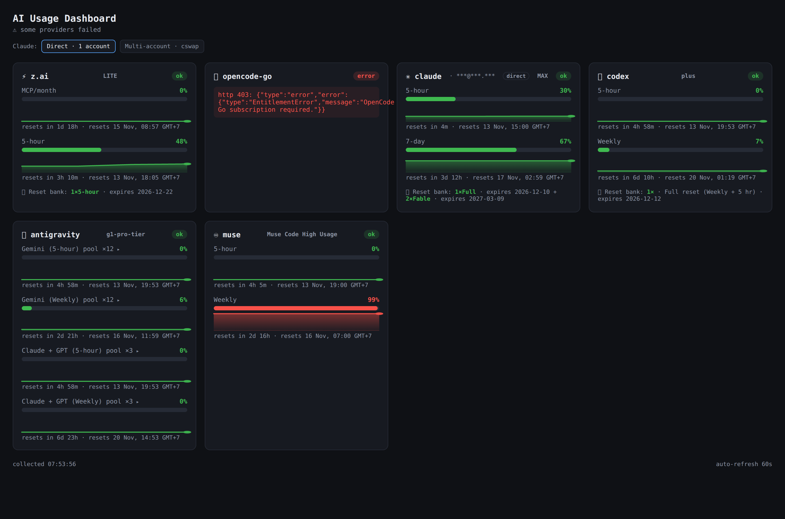

# AI Usage Dashboard (`aidash`)

An on-machine dashboard that pulls usage/credit usage data from multiple AI providers and visualizes it in one web page.

- Backend: `Rust + Axum`
- Frontend: `index.html` embedded in binary via `include_str!`
- Storage: in-memory snapshot buffer (no database)
- Providers: **z.ai**, **OpenCode Go**, **Claude**, **Codex**, **Antigravity**, **Muse Code**

---

## Features

- Single-page dashboard at `/`
- Provider usage graphs and status cards
- **Reset bank** per provider: how many usage-window reset credits z.ai (GLM), Codex and Claude accounts still hold, with expiry — read-only, spending stays on each vendor's own page
- API endpoints:
  - `GET /data.json` for latest snapshot
  - `GET /history.json` for historical snapshots used by sparkline charts
- First snapshot is collected on startup, then refreshed by a background loop
- `tmux` control script (`ctl.sh`) for convenient process control

### z.ai (GLM Coding Plan)

- Reads a Bearer API key from a plain text file (default `$HOME/aidash/zai.key`; override with `ZAI_KEY_FILE`)
- Queries `https://api.z.ai/api/monitor/usage/quota/limit` for the plan's usage windows (**5-hour**, **Weekly**, **MCP/month**)
- **Reset bank**: also queries `https://api.z.ai/api/biz/customer-package-reset/list?targetType=PERSONAL` and shows how many window resets the plan still holds (5-hour / weekly) and when the soonest one expires. A reset can only be spent on z.ai's own usage page — no spend API exists, aidash is read-only

### Claude

- **Direct mode** is the default and preserves the original behavior: read active credentials from `$HOME/.claude/.credentials.json`, query `https://api.anthropic.com/api/oauth/usage`, and show one account with token auto-refresh.
- **Reset bank (cedar_ember)**: the usage query now asks as Claude Code does (`?cedar_ember=1&skip_spend=1`, `User-Agent: claude-cli/<ver>`) and shows the account's usage-limit reset grants, grouped **Full** (clears the weekly window) vs model-named grants from the label (e.g. **Fable**), each with count and soonest expiry. Display only: a grant is spent from Claude Code's own `/limit-reset` (`POST /api/organizations/{org}/reset_rate_limits`), never from aidash. With a non-`claude-cli` User-Agent the endpoint answers `eligible:false, reason:"surface"` and no reset bank is shown.
- Use the **Multi-account · cswap** button to run `claude-swap list --json` and show every managed account's cached usage. Aidash never reads or decrypts cswap credentials. Only selected mode is polled, avoiding duplicate usage requests.
- Multi-account refresh follows claude-swap's per-account adaptive polling schedule, not aidash's collection interval (120 seconds via `ctl.sh`; binary default 300 seconds). `list --json` can return cached values for several minutes (sometimes around 10 minutes) until cswap's next poll; Direct mode polls on aidash's interval.
- The mode button only changes which usage view aidash collects; it does not switch Claude Code accounts. Switch accounts separately with `claude-swap switch <number|email>`.
- `CLAUDE_CRED_FILE` overrides the direct credential path. `CLAUDE_CRED_FILES` supports direct polling of multiple files. `CLAUDE_SWAP_BIN` selects the cswap executable; set it empty to disable multi-account mode.

### OpenCode Go

- Reads a Bearer API key from a plain text file (default `$HOME/aidash/opencode-go.key`; override with `OPENCODE_GO_KEY_FILE`)
- Queries `https://opencode.ai/zen/go/v1/usage` and reports all three usage windows: **5-hour** (rolling), **Weekly**, **Monthly** with reset countdowns
- Passive read-only usage endpoint — polling does not consume quota
- Plan badge shows `Go`

### Codex (OpenAI)

- Reads OAuth tokens from `~/.codex/auth.json` (path from `CODEX_AUTH_FILE`) and auto-refreshes the access token via `auth.openai.com` when it expires (set `CODEX_DISABLE_REFRESH=1` to skip)
- Queries `https://chatgpt.com/backend-api/wham/usage` — the same passive usage endpoint the Codex CLI polls; polling does not consume quota
- Main usage windows are labeled by their real duration from `window_seconds`: **5-hour** (primary window) and **Weekly** (secondary window); unrecognized durations fall back to the raw API names
- Per-model extra limits (`additional_rate_limits`) are shown as `<name> (5-hour)` / `<name> (Weekly)`
- **Reset bank**: shows the account's rate-limit reset credits (`rate_limit_reset_credits` from the usage payload, detail from `wham/rate-limit-reset-credits`) — count, title, and when the soonest expires. Display only: a credit is spent from Codex's own UI, not from aidash
- Note: OpenAI has announced merging ChatGPT and Codex allowances (token-based) starting December 2026; the usage response shape may change then

### Antigravity (Google)

- Reads the local OAuth token from `~/.gemini/antigravity-cli/antigravity-oauth-token` (created by the `agy` CLI / Antigravity IDE login)
- Queries the Gemini Cloud Code internal API via `/v1internal:retrieveUserQuotaSummary` for dual-window quotas (**5-hour** and **Weekly**) across both Gemini and 3rd-party (Claude + GPT) pools
- Identifies as the Antigravity Hub client (`User-Agent: antigravity/hub/2.9.x`) and hits `daily-cloudcode-pa.googleapis.com` first — the live quota pool the `agy` CLI reads from; a plain `antigravity/<ver>` UA or the prod host alone serves a stale Gemini pool pinned at 100% remaining (refs: steipete/CodexBar#4102, decolua/9router#3891). Falls back to `cloudcode-pa.googleapis.com` on 403/404/5xx
- Models sharing a quota pool (identical `remainingFraction`) collapse into one row (e.g. *Gemini pool ×17*); click to expand the model list
- Deprecated model aliases (from the API's `deprecatedModelIds`, e.g. `gemini-3.1-pro-high` → `gemini-pro-agent`) are merged so pools count real models, not aliases
- Tiered models (`*-tiered`, e.g. `gemini-3.8-flash-tiered`) are normalized to their clean model name (`gemini-3.8-flash`); unnamed internal entries (`chat_*`, `tab_*`) are skipped
- Robust quota extraction: any models unrepresented in `retrieveUserQuotaSummary` are automatically extracted from `fetchAvailableModels` `quotaInfo`
- A pool that hit its 5-hour limit shows as **100% — limit hit** with reset countdown
- Models with no quota data yet are grouped into a grey *no quota data* row
- Plan/tier badge (e.g. `g1-pro-tier`) via `loadCodeAssist`
- Auto-refreshes the OAuth token on 401 (read-only; never writes back to the token file)
- Override token path with `ANTIGRAVITY_TOKEN_FILE`, API base URL with `ANTIGRAVITY_BASE_URL` (default: `https://daily-cloudcode-pa.googleapis.com` first, fallback `https://cloudcode-pa.googleapis.com`)

### Muse Code (Meta)

- Reads the OAuth device-code token from `providers.meta.access_token` in `~/.config/muse/auth.json` (created by `muse login`; override path with `MUSE_AUTH_PATH`, `$XDG_CONFIG_HOME` is respected)
- Queries the same endpoint the CLI uses at startup: `POST https://api.meta.ai/muse-code/key` (body `{}`, header `x-api-version: 1.0.0`) and keeps only the `subs_usage` quota block: **5-hour** window (`used_percent`, `window_duration_mins`, `resets_at` in unix seconds) and **Weekly** window
- Plan badge from `subs_tier_name` (e.g. `Muse Code High Usage`); requires `is_subs_active: true`
- Meta omits `subs_usage` while the window is idle — an active plan with no quota block shows an empty card (not an error, never an invented 0%)
- Polling does not consume quota; the minted `api_key` in the response is discarded and never logged

## UI Page



This is the live dashboard page rendered at `/`.

- `index` serves this page directly from embedded HTML
- cards refresh automatically and poll `/data.json`
- history chart uses a gradient filled area sparkline (instead of line-only) from `/history.json`

Recent UI refresh details:

- sparkline now renders filled gradient area to emphasize trend shape
- each series has a stronger stroke and explicit baseline for better readability
- single-point history uses a minimal filled baseline shape for consistent appearance

To open the actual page:

```bash
./target/release/aidash
# open http://127.0.0.1:8000
```

To view static structure only (no backend needed), open [index.html](/home/dump/aidash/index.html) directly.

---

## Project structure

- `src/main.rs`: Axum server + provider collectors
- `index.html`: dashboard UI
- `ctl.sh`: control helper (`start|stop|restart|status|attach|logs`)
- `Cargo.toml`: Rust dependencies
- `.gitignore`: excludes build output and key files

---

## Build

```bash
cargo build --release
```

Binary output: `target/release/aidash`

---

## Run directly

```bash
export AIDASH_LISTEN=0.0.0.0:8000
export AIDASH_INTERVAL=300
./target/release/aidash
```

Defaults in code:

- `AIDASH_LISTEN`: `0.0.0.0:8000`
- `AIDASH_INTERVAL`: `300` (seconds)
- `ZAI_KEY_FILE`: `$HOME/aidash/zai.key`
- `OPENCODE_GO_KEY_FILE`: `$HOME/aidash/opencode-go.key`
- `CLAUDE_CRED_FILES`: comma-separated direct-mode credential files, each optionally `label=path` (takes precedence over `CLAUDE_CRED_FILE`)
- `CLAUDE_CRED_FILE`: `$HOME/.claude/.credentials.json`
- `CLAUDE_SWAP_BIN`: `claude-swap` executable path (auto-detected under `$HOME/.local/bin` or `PATH`; empty disables it)
- `CODEX_AUTH_FILE`: `$HOME/.codex/auth.json`
- `ANTIGRAVITY_TOKEN_FILE`: `$HOME/.gemini/antigravity-cli/antigravity-oauth-token`
- `MUSE_AUTH_PATH`: `$HOME/.config/muse/auth.json` (`$XDG_CONFIG_HOME/muse/auth.json` when set)

---

## Manage with `ctl.sh`

```bash
./ctl.sh start
./ctl.sh status
./ctl.sh logs
./ctl.sh stop
```

Log file: `aidash.log` (created while running via script)

Default script overrides:

- `AIDASH_INTERVAL` = `120`
- `AIDASH_LISTEN` = `0.0.0.0:8000`

Example with custom values:

```bash
AIDASH_INTERVAL=120 AIDASH_LISTEN=127.0.0.1:9000 ./ctl.sh start
```

---

## API examples

### `GET /data.json`

```json
{
  "collected": "2026-08-06T00:00:00Z",
  "ts": 1754448000,
  "any_error": false,
  "providers": [
    {
      "provider": "claude",
      "account": "you@example.com",
      "status": "ok",
      "plan": null,
      "limits": [
        {
          "label": "5-hour",
          "used_percent": 42.3,
          "remaining_percent": 57.7,
          "resets_at": 1754486400
        }
      ]
    },
    {
      "provider": "antigravity",
      "status": "ok",
      "plan": "g1-pro-tier",
      "limits": [
        {
          "label": "Gemini (Weekly) pool ×16",
          "models": ["gemini-3.6-flash-medium", "gemini-pro-agent", "..."],
          "used_percent": 4.5,
          "remaining_percent": 95.5,
          "resets_at": 1786886264
        },
        {
          "label": "Claude + GPT pool ×3 — limit hit",
          "models": ["claude-opus-4-6-thinking", "claude-sonnet-4-6", "gpt-oss-120b-medium"],
          "used_percent": 100.0,
          "remaining_percent": 0.0,
          "resets_at": 1786886250
        }
      ]
    },
    {
      "provider": "muse",
      "status": "ok",
      "plan": "Muse Code High Usage",
      "email": "you@example.com",
      "limits": [
        {
          "label": "5-hour",
          "used_percent": 3.0,
          "remaining_percent": 97.0,
          "window_seconds": 18000,
          "resets_at": 1791090614
        },
        {
          "label": "Weekly",
          "used_percent": 1.0,
          "remaining_percent": 99.0,
          "window_seconds": 604800,
          "resets_at": 1791158400
        }
      ]
    }
  ]
}
```

### `GET /history.json`

Array of snapshots, each containing trimmed provider usage points for sparkline rendering.

---

## Required credentials

- z.ai: token text file (path from `ZAI_KEY_FILE`)
- OpenCode Go: API key text file (path from `OPENCODE_GO_KEY_FILE`; from `opencode auth login -p opencode-go` or the OpenCode Go console)
- Claude: direct mode reads active JSON credential at `CLAUDE_CRED_FILE` (default `$HOME/.claude/.credentials.json`); multi-account mode reads usage from `claude-swap list --json`
- Codex: JSON file with:
  - `tokens.access_token`
  - `tokens.refresh_token` (used when access token expires, unless `CODEX_DISABLE_REFRESH=1`)
- Antigravity: JSON file with `token.access_token` / `token.refresh_token` (path from `ANTIGRAVITY_TOKEN_FILE`; created by `agy` login)
- Muse Code: JSON file with `providers.meta.access_token` (path from `MUSE_AUTH_PATH`; created by `muse login`). `LLM_...` dashboard keys and `LLM|...` inference keys cannot read this quota (401) — must be the `dca:...` OAuth token.

Never commit these credential files.

---

## Notes

- Parsing depends on current provider API response shape; schema changes may require code updates.
- Keep credentials on trusted machines only.
- Frontend refreshes data every 60 seconds by default.

---

## License / scope

This is a personal dashboard project intended for local use.
